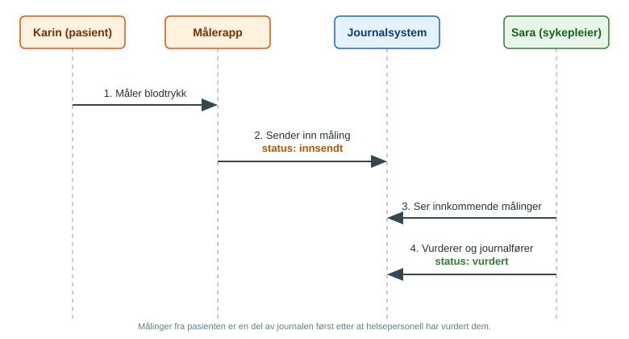

### Blodtrykk hjemme

Dette er en øvingsguide laget under Norwegian FHIR Hackathon 2026 (FHIR-101). Den beskriver hvordan blodtrykksmålinger tatt av pasienten hjemme kan uttrykkes i HL7 FHIR og sendes til helsepersonell for vurdering. Guiden er et utkast og beskriver ingen ferdig integrasjon. Alle personer og data i eksemplene er oppdiktet.

### Mål

Målet med guiden er å vise en enkel og standardisert måte å representere hjemmemålt blodtrykk på, slik at målingene kan utveksles mellom pasientens målerapp, legekontoret og journalsystemet. Guiden skal også vise hvordan man skiller mellom målinger pasienten har sendt inn og målinger helsepersonell har vurdert.

### Omfang

Guiden dekker:

- Beskrivelse av use case, aktører, krav og prosess
- En FHIR-modell for pasient, måleenhet og blodtrykksmåling
- Eksempler på oppdiktede pasienter og målinger

Guiden dekker ikke:

- Tolkning av målingene eller behandling
- Alarmer og automatisk oppfølging
- Integrasjon mot konkrete journalsystemer

### Brukstilfelle

#### Hjemmemåling av blodtrykk

Karin Testdal (78 år) måler blodtrykket hjemme med en målerapp koblet til et blodtrykksapparat. Målingene sendes til legekontoret. Sykepleier Sara Testesen går gjennom målingene og avgjør om Karin trenger oppfølging.

Målingene fra Karin regnes som innsendt av pasienten til Sara har vurdert dem. Først da er de en del av pasientens journal.

#### Aktører

| Aktør | Rolle |
|---|---|
| Pasient | Måler blodtrykket og sender inn målingene |
| Sykepleier | Vurderer målingene og bestemmer oppfølging |
| Journalsystemet | Tar imot og lagrer målingene |

### Modell

| Begrep | FHIR-ressurs |
|---|---|
| Pasienten | `Patient` |
| Blodtrykksapparatet | `Device` |
| Blodtrykksmålingen | `Observation` med systolisk og diastolisk trykk som komponenter |

### Figur

Flyten fra måling til vurdering.

