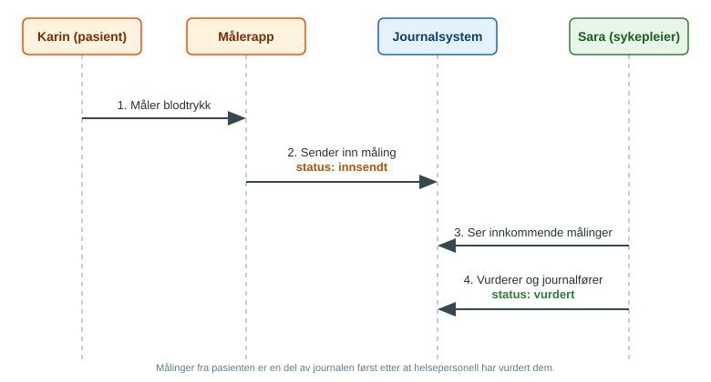

# Prosess

Figuren viser flyten fra hjemmemåling til vurdering i journalsystemet.

1. Pasienten måler blodtrykket med et tilkoblet blodtrykksapparat.
2. Måleappen sender målingen til legekontoret. Den registreres som innsendt og ikke vurdert.
3. Sykepleier eller lege ser den innkomne målingen.
4. Helsepersonell vurderer målingen og registrerer den som vurdert i journalen.
